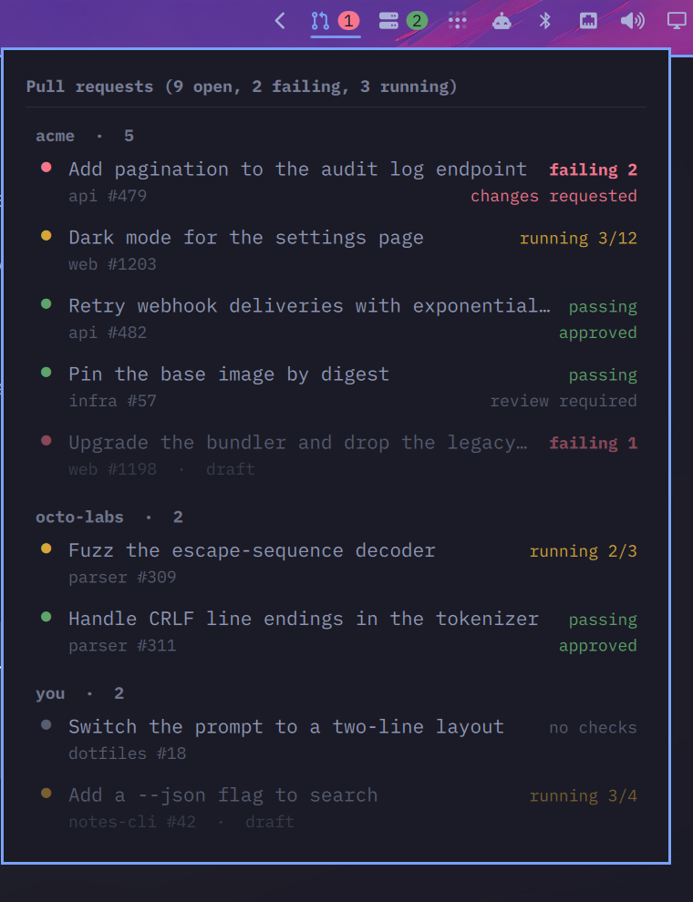
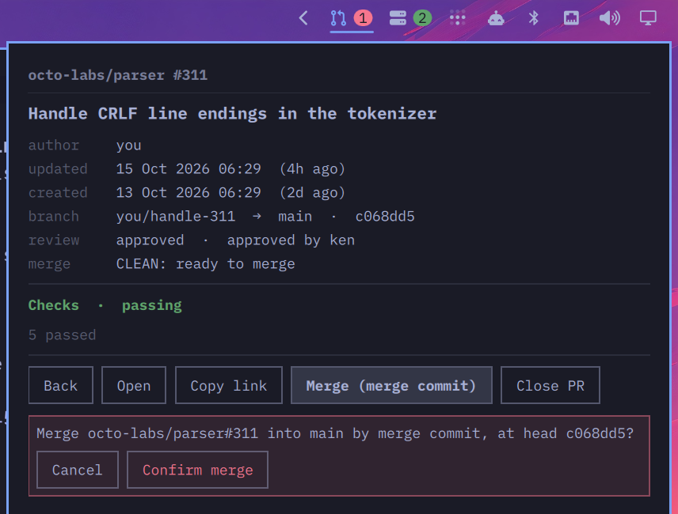

# GitHub PRs for Omarchy

A bar widget for the [Omarchy](https://omarchy.org) shell: every pull request
you have open on GitHub, whether its checks pass, how long since it moved, and
a detail view that can copy, merge or close it.



## What it shows

The bar shows a pull-request icon and a badge: by default, how many of your
non-draft PRs have failing checks. The badge is red when something counted is
failing, yellow when it is only counting checks still running, and gone when
there is nothing to count. The tooltip spells out the totals.

The panel lists every open PR, grouped by the org or user that owns the
repository, in one of two orders, switched from the header:

- **By status** (the default): within each owner, passing PRs first, then
  running, failing, and those with no checks, drafts after the rest in each,
  and newest first within that. Owners with anything passing come first, then
  by their most recently updated PR.
- **By date**: newest first, PRs and owners alike, whatever their checks say.

The choice is saved in `~/.local/state/omarchy-gh-prs/sort`, so it survives a
restart. Each row has:

- **A dot** for the head commit's checks:
  - **green**: every check finished and passed (success, neutral or skipped)
  - **yellow**: something is still queued, pending or in progress
  - **red**: something failed, was cancelled, timed out, or needs approval to run
  - **grey**: no checks at all
- **The title**, elided to fit, with the repository and number under it.
- **A status** on the right: `passing`, `running 3/12` (finished of total),
  `failing 2`, or `no checks`; and under it the review decision when there is
  one (`approved`, `changes requested`, `review required`) and how long since
  the PR was last updated (`40m`, `5h`, `3d`, `2w`).

Red wins over yellow: one failed check decides a PR, however many are still
going. Drafts are drawn dimmed. A PR not updated in 14 days is dimmed too, and
its age reads `stale · 2w`.

Hovering a row shows a summary: the full title, author, created and updated
dates, branches, review decision and check counts.

## The detail view

Click a row (or press `Enter` on it) for everything about that PR:



- author, created and updated (absolute and relative), `head → base` and the
  head commit
- the review decision, who approved, who asked for changes, and who is still
  requested
- GitHub's merge state (`CLEAN`, `BLOCKED`, `BEHIND`, `DIRTY`, ...) in words
- every failing check by name, then every running one, then a count of the
  passed, skipped and neutral ones

And the actions:

- **Open** opens the PR in the browser.
- **Copy link** puts its URL on the clipboard (`wl-copy`) and says *Copied*.
- **Merge** merges it with `gh pr merge`, using squash when the repository
  allows it, then a merge commit, then rebase. The button is greyed out, with
  the reason under it, while the PR is a draft, conflicts with its base, has a
  failing or running check, is waiting on a review, or is blocked or behind
  by GitHub's own rules.
- **Close PR** closes it without merging. Deleting its branch is a separate,
  off-by-default switch in the confirm row.

Merge and Close each take two clicks: the button opens a confirm row that says
exactly what will happen (the repository and number, and the merge method and
head commit, or the title of the PR being closed), and only its *Confirm*
button does it. The result shows in the panel, and the list refreshes.

A merge always passes `--match-head-commit` with the head commit the detail
view showed, so a commit pushed after you looked is never merged unseen:
GitHub refuses the merge instead. It never passes `--admin`.

## Keys

| Key | List | Detail view |
|-----|------|-------------|
| `↑` `↓` | move between PRs | |
| `s` | switch between by status and by date | |
| `Enter` | open the detail view | |
| `o` | open the PR in the browser | open the PR in the browser |
| `c` | | copy the link |
| `m` / `x` | | arm Merge / Close PR (the confirm is still a click) |
| `r` | refresh | refresh the list and this PR |
| `Esc` / `←` | close the panel | cancel a confirm, then back to the list |

A middle click on a row opens it in the browser; a middle click on the bar
button refreshes. Clicking outside the panel closes it from either view.

## Refreshing

The list refreshes every 60 seconds and whenever the panel opens (unless it is
only seconds old). With a hundred-odd PRs a refresh takes several seconds; the
panel shows what it had until the new list arrives. The detail view fetches
its PR when it opens, which takes about a second.

When GitHub cannot be reached, or `gh` is not signed in, the last good list
stays on screen with one line in red above it saying why and how old the list
is. Nothing pops up and nothing is retried faster than the normal interval.

## Settings

Set these on the widget's entry in `~/.config/omarchy/shell.json`, or from the
shell's settings panel:

| Key           | Default   | Meaning |
|---------------|-----------|---------|
| `badge`       | `failing` | What the badge counts: `failing`, `active` (failing and running) or `none` |
| `badgeDrafts` | `false`   | Count draft PRs in the badge too |
| `interval`    | `60`      | Seconds between refreshes (at least 30) |
| `query`       | blank     | A GitHub search to use instead of `is:pr is:open author:@me archived:false` |

```json
{ "id": "io.github.travisjeffery.gh-prs", "badge": "active", "interval": 120 }
```

`query` takes anything GitHub's search box does, so `is:pr is:open
review-requested:@me` turns the widget into a review queue.

## How it works

`bin/gh-prs` does all the GitHub work through your existing `gh` login and
prints JSON for the panel to draw:

- `list` runs one GitHub GraphQL search, paged 50 at a time. Each PR's checks
  come from its head commit's status rollup as counts per state, so a PR with
  eighty checks costs no more than one with two.
- `detail` fetches one PR with its check names, reviewers and mergeability.
  Those are what make a search slow (with them, even 25-PR pages run into
  GitHub's ten-second limit), so they are fetched for the PR you open, when
  you open it, which is also when they need to be current.
- `merge`, `close` and `copy` do what the buttons say.

A gateway timeout from GitHub is retried once. Nothing in the plugin holds a
token. Titles and names from GitHub are drawn as plain text, and every
argument the panel passes back (repository, number, method, commit, URL) is
checked for shape before it reaches a command line.

## Installing it

```bash
omarchy plugin add https://github.com/travisjeffery/omarchy-gh-prs --enable
```

That clones the repository into
`~/.config/omarchy/plugins/io.github.travisjeffery.gh-prs`, checks it, and puts
the widget on the bar. Update it later with
`omarchy plugin update io.github.travisjeffery.gh-prs`.

### Requirements

- [`gh`](https://cli.github.com), signed in with `gh auth login`
  (`omarchy pkg add github-cli` if you don't have it)
- `jq`
- `wl-copy` (from `wl-clipboard`), for *Copy link*
- `xdg-open` (from `xdg-utils`), to open PRs in the browser

### What it can do with your account

The widget runs `gh` as you, with whatever access your `gh` login has, and
holds no token of its own. Listing, the detail view and *Open* only read.
**Merge** and **Close PR** write: they run `gh pr merge` and `gh pr close` on
the PR you picked, with your permissions, and with *delete branch* switched on
Close also deletes the PR's branch. Each happens only after its *Confirm*
button, and a merge is pinned to the head commit you were shown. It never
passes `--admin`, so branch protection applies to you as it does on GitHub.

Outside its own folder it writes the sort order to
`~/.local/state/omarchy-gh-prs/sort`, and a demo-mode flag under
`~/.cache/omarchy-gh-prs/` when you turn demo mode on.

## Screenshots

The data script has a demo mode, so a screenshot never carries real PR titles.
While it is on, Merge and Close do nothing:

```bash
bin/gh-prs demo on
# ... open the panel, take the screenshot ...
bin/gh-prs demo off
```

## Developing it

To work on a checkout, link it into the plugins folder instead of adding it:

```bash
git clone https://github.com/travisjeffery/omarchy-gh-prs ~/src/omarchy-gh-prs
ln -s ~/src/omarchy-gh-prs ~/.config/omarchy/plugins/io.github.travisjeffery.gh-prs
omarchy-shell shell rescanPlugins
omarchy plugin enable io.github.travisjeffery.gh-prs --section right
```

The shell watches `~/.config/omarchy/plugins` but does not follow the link, so
run `omarchy restart shell` after a change. Check it with:

```bash
omarchy plugin validate ~/src/omarchy-gh-prs
qmllint -I "${OMARCHY_PATH:-/usr/share/omarchy}/shell" ~/src/omarchy-gh-prs/Panel.qml
```

## Removing it

```bash
omarchy plugin remove io.github.travisjeffery.gh-prs
rm -rf ~/.cache/omarchy-gh-prs ~/.local/state/omarchy-gh-prs
```

`remove` takes the widget off the bar and deletes the plugin folder (for a
linked checkout, only the link).

## License

MIT. See [LICENSE](LICENSE).
